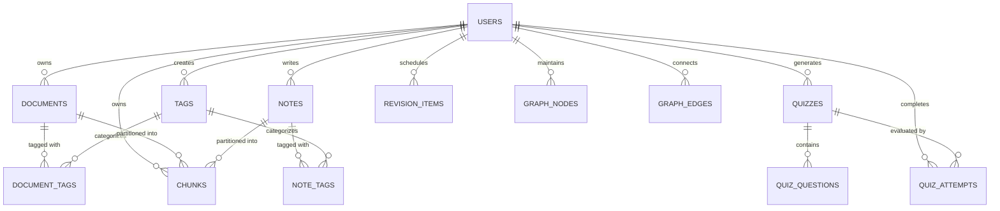

# Database Schema & Data Modeling

## 1. Overview
The database layer uses **SQLAlchemy 2.0 ORM** with **SQLite 3** operating in **Write-Ahead Logging (WAL)** mode. Foreign key constraints and normal synchronous mode are enabled by default, ensuring immediate durability, concurrency, and cross-platform reliability without requiring a separate database server.

---

## 2. Entity-Relationship Diagram (Mermaid)

---

## 3. Table Specifications

### `users`
| Column | Type | Constraints | Description |
|--------|------|-------------|-------------|
| `id` | INTEGER | PRIMARY KEY, AUTOINCREMENT | Unique user identifier |
| `email` | VARCHAR(255) | UNIQUE, NOT NULL, INDEX | User login email address |
| `hashed_password` | VARCHAR(255) | NOT NULL | Bcrypt password hash |
| `full_name` | VARCHAR(255) | NOT NULL | Display name |
| `avatar_url` | VARCHAR(500) | NULLABLE | Profile picture URL |
| `bio` | TEXT | NULLABLE | Academic/study biography |
| `role` | VARCHAR(50) | DEFAULT 'student' | System role |
| `is_active` | BOOLEAN | DEFAULT TRUE | Account activation flag |
| `created_at` | DATETIME | DEFAULT UTC NOW | Registration timestamp |
| `updated_at` | DATETIME | ON UPDATE UTC NOW | Last profile update |

### `documents`
| Column | Type | Constraints | Description |
|--------|------|-------------|-------------|
| `id` | INTEGER | PRIMARY KEY, AUTOINCREMENT | Document identifier |
| `user_id` | INTEGER | FK -> users.id (CASCADE), INDEX | Owner user ID |
| `title` | VARCHAR(255) | NOT NULL, INDEX | Document title |
| `original_filename` | VARCHAR(255) | NOT NULL | Original upload name |
| `stored_filename` | VARCHAR(255) | NOT NULL | UUID storage name |
| `file_path` | VARCHAR(500) | NOT NULL | Absolute disk path |
| `file_type` | VARCHAR(50) | NOT NULL | pdf, image, text, doc |
| `file_size` | INTEGER | NOT NULL | File size in bytes |
| `mime_type` | VARCHAR(100) | NOT NULL | MIME content type |
| `processing_status` | VARCHAR(50) | DEFAULT 'pending', INDEX | pending, processing, completed, failed |
| `error_message` | TEXT | NULLABLE | Extraction failure reason |
| `extracted_text` | TEXT | NULLABLE | Raw text extracted |
| `page_count` | INTEGER | DEFAULT 1 | Total pages parsed |
| `word_count` | INTEGER | DEFAULT 0 | Extracted word count |
| `char_count` | INTEGER | DEFAULT 0 | Extracted character count |
| `summary` | TEXT | NULLABLE | Executive AI summary |
| `key_takeaways` | JSON | NULLABLE | Array of key bullet points |
| `category` | VARCHAR(100) | DEFAULT 'General', INDEX | Primary topic category |
| `created_at` | DATETIME | DEFAULT UTC NOW | Upload timestamp |
| `updated_at` | DATETIME | ON UPDATE UTC NOW | Last modified timestamp |

### `notes`
| Column | Type | Constraints | Description |
|--------|------|-------------|-------------|
| `id` | INTEGER | PRIMARY KEY, AUTOINCREMENT | Note identifier |
| `user_id` | INTEGER | FK -> users.id (CASCADE), INDEX | Owner user ID |
| `title` | VARCHAR(255) | NOT NULL, INDEX | Note title |
| `content` | TEXT | NOT NULL | Markdown note body |
| `summary` | TEXT | NULLABLE | Generated note summary |
| `category` | VARCHAR(100) | DEFAULT 'General', INDEX | Subject classification |
| `word_count` | INTEGER | DEFAULT 0 | Total words in content |
| `is_pinned` | BOOLEAN | DEFAULT FALSE | Pinned to top indicator |
| `is_archived` | BOOLEAN | DEFAULT FALSE | Archived indicator |
| `created_at` | DATETIME | DEFAULT UTC NOW | Creation timestamp |
| `updated_at` | DATETIME | ON UPDATE UTC NOW | Last update timestamp |

### `chunks` (Vector & Text Retrieval)
| Column | Type | Constraints | Description |
|--------|------|-------------|-------------|
| `id` | INTEGER | PRIMARY KEY, AUTOINCREMENT | Chunk ID |
| `user_id` | INTEGER | FK -> users.id (CASCADE), INDEX | Owner user ID |
| `document_id` | INTEGER | FK -> documents.id (CASCADE), INDEX | Parent document (if doc) |
| `note_id` | INTEGER | FK -> notes.id (CASCADE), INDEX | Parent note (if note) |
| `chunk_index` | INTEGER | NOT NULL | Sequential chunk order |
| `content` | TEXT | NOT NULL | Chunk text window (~500 chars) |
| `token_count` | INTEGER | DEFAULT 0 | Words in chunk |
| `embedding` | JSON | NULLABLE | Sparse L2-normalized TF-IDF vector |
| `created_at` | DATETIME | DEFAULT UTC NOW | Index timestamp |

### `quizzes` & `quiz_questions`
- `quizzes`: Stores quiz metadata (`id`, `user_id`, `title`, `source_type`, `question_count`).
- `quiz_questions`: Stores individual questions (`question_text`, `question_type`, `options` JSON array, `correct_answer`, `explanation`, `source_excerpt`).

### `quiz_attempts`
- Logs user scores (`score` percentage, `correct_count`, `total_questions`, `time_taken_seconds`, `completed_at`).

### `revision_items` (Spaced Repetition)
- Stores item type (`note`, `document`, `concept`, `quiz_question`), `repetition_level`, `interval_days`, `ease_factor`, `next_review_date`, and `review_count`.
